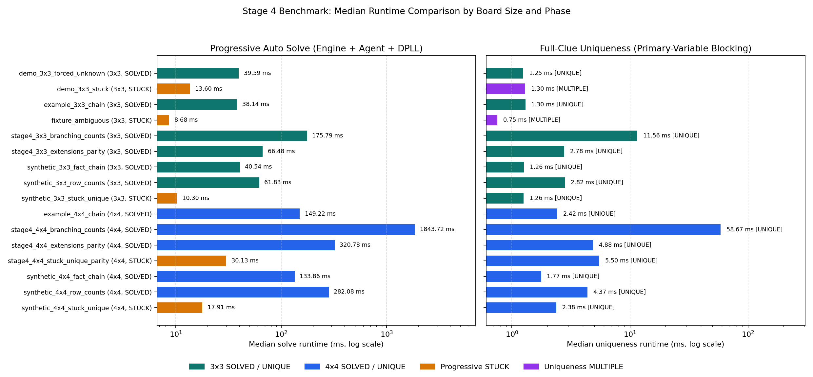
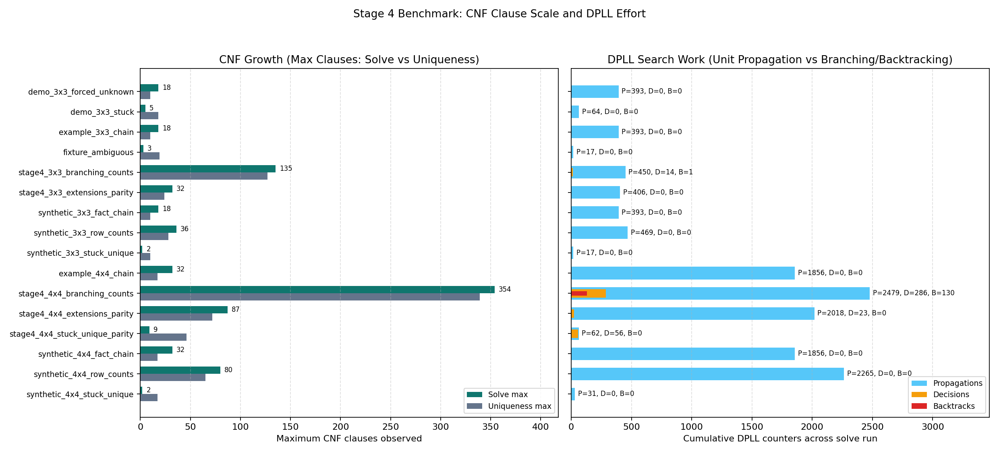
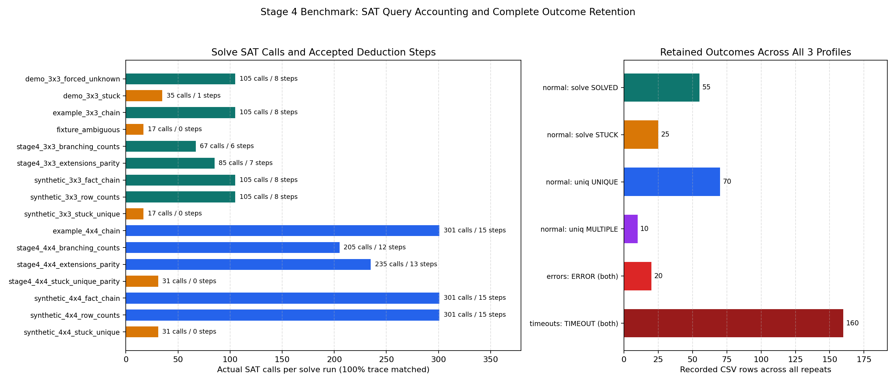

# TV3 — Thuật toán DPLL, Kiểm tra Uniqueness và Thực nghiệm Hiệu năng (Giai đoạn 4)

> Bản báo cáo chốt phần TV3 cho deadline 21/11/2026 (Asia/Saigon), tổng hợp thuật toán
> DPLL, kiểm tra uniqueness trên biến chính, cấu hình thực nghiệm, số liệu CSV, biểu đồ
> và phân tích hiệu năng trên base `integration_v2` (`43e5f53`). Các bản snapshot trước
> được giữ nguyên tại [tv3.md](tv3.md) (09/11) và [tv3_phase3.md](tv3_phase3.md) (14/11).

- **Phụ trách:** TV3 — Mạnh.
- **Branch làm việc:** `feature/TV3-dpll-uniqueness-experiments` (đã đồng bộ `origin/integration_v2` tại `43e5f53`).
- **Phạm vi đóng góp TV3:** `Source/solver/` (`dpll.py`, `uniqueness.py`, `_timing.py`), `Source/experiments/` (`benchmark.py`, `make_suite.py`, `make_stage4_suite.py`, `phase3.py`, `phase4.py`), bộ test TV3 (`test_dpll.py`, `test_uniqueness.py`, `test_benchmark.py`, `test_phase3_backend.py`, `test_phase4_acceptance.py`) và bộ kết quả/biểu đồ thực nghiệm. Không thay đổi model, Protocol, schema hay dependency trong contract v1.

---

## 1. Thuật toán DPLL tự cài đặt

### 1.1. Biểu diễn dữ liệu và kiểm tra hợp lệ

`DPLLSolver.solve(cnf, variables, assumptions=(), *, timeout_seconds=None)` nhận:
- `cnf: list[list[int]]` (dạng chuẩn hội CNF: AND của các mệnh đề OR). CNF rỗng `[]` có giá trị `True`; chứa mệnh đề rỗng `[]` có giá trị `False`.
- `variables: Sequence[int]`: tập ID biến dương không trùng, bao phủ mọi biến xuất hiện trong `cnf` và `assumptions`. Biến chính ứng với board $N \times N$ đánh số $1 \dots N^2$ theo thứ tự row-major (`row * N + col + 1`); biến phụ (nếu có) bắt đầu từ $N^2 + 1$.
- `assumptions: Sequence[int]`: các unit literal tạm cho lần gọi hiện tại (ví dụ `-Ci` để kiểm chứng `CRIMINAL`, `+Ci` để kiểm chứng `INNOCENT`). Hai assumption đối nhau (`v` và `-v`) trả về `UNSAT`, không phải lỗi đầu vào.
- `timeout_seconds: float | None`: `None` là không giới hạn; số thực/nguyên dương hữu hạn là hạn mức wall-clock. Mọi giá trị sai kiểu (gồm `bool`, `0`, số âm, `NaN`, `inf`) hoặc literal `0` / biến chưa khai báo đều raise `ContractError` trước khi tìm kiếm.

Solver **không bao giờ sửa đầu vào** (`cnf`, `variables`, `assumptions`) và không lưu trạng thái tìm kiếm trên instance (`DPLLSolver` an toàn khi tái sử dụng hoặc chạy song song nhiều luồng). Trước khi tìm kiếm, `_normalize` sao chép CNF sang cấu trúc `tuple` bất biến, loại bỏ literal lặp trong cùng clause và loại clause tautology (chứa cả $l$ và $-l$).

### 1.2. Unit propagation, conflict detection, branching và backtracking

Khi gán một literal $l$:
1. Loại mọi clause chứa $l$ (clause đã được thỏa).
2. Loại $-l$ khỏi các clause còn lại (literal sai).
3. Nếu xuất hiện clause rỗng `()`, nhánh hiện tại phát sinh xung đột (conflict).

Mã giả thuật toán tìm kiếm đệ quy (`_search` trong `Source/solver/dpll.py`):

```text
search(clauses, assignment, ordered_variables):
    deadline.check()
    # 1. Unit propagation đến điểm bất động
    while True:
        deadline.check()
        if exists empty clause in clauses:
            return None                      # Conflict
        if clauses is empty:
            return assignment                # Mọi clause đã thỏa
        unit = first clause of length 1
        if unit is None:
            break
        assignment[abs(unit)] = (unit > 0)
        counters.propagations += 1
        clauses = reduce(clauses, unit)

    # 2. Chọn biến deterministic: ID nhỏ nhất chưa gán
    v = smallest variable in ordered_variables not in assignment
    counters.decisions += 1

    # 3. Rẽ nhánh thử True trước, False sau
    for lit in (+v, -v):
        child_assignment = assignment.copy()
        child_assignment[v] = (lit > 0)
        model = search(reduce(clauses, lit), child_assignment, ordered_variables)
        if model is not None:
            return model
        counters.backtracks += 1
    return None
```

- **Complete assignment:** Khi `_search` trả về nghiệm hợp lệ, solver hoàn thiện mọi biến tự do chưa cần gán trong `variables` bằng `False`, đảm bảo trả về `dict[int, bool]` đầy đủ đúng tập biến khai báo. Khi vô nghiệm (`UNSAT`), `assignment` là `None`.
- **Thống kê từng lời gọi (`SolverStats`):**
  - `decisions`: số lần chọn biến rẽ nhánh (không đếm 2 giá trị `True`/`False` thành 2 decisions).
  - `propagations`: số phép gán mới sinh ra từ unit propagation (không tính assumptions, decision hay bước điền `False` cuối).
  - `backtracks`: số nhánh thất bại bị rút lại.
  - `runtime_seconds`: thời gian đo bằng `time.perf_counter()`, bao gồm validation và tìm kiếm.
- **Timeout (`_Deadline`):** Kiểm tra wall-clock xuyên suốt validation, chuẩn hóa, rút gọn, unit propagation và đệ quy. Khi quá hạn, raise `SolverTimeout` — **tuyệt đối không chuyển timeout thành `UNSAT`** hay trả assignment giả.

### 1.3. Độ phức tạp và giới hạn thuật toán

- Trường hợp xấu nhất của DPLL cơ bản là $O(2^V \cdot L)$ với $V$ là số biến và $L$ là tổng số literal trong CNF.
- Phiên bản hiện tại ưu tiên tính đúng đắn, hoàn toàn xác định (deterministic) và dễ kiểm chứng cho board nhỏ ($3\times 3, 4\times 4, 5\times 5$); chưa áp dụng CDCL, clause learning, watched literals hay heuristic chọn biến động (VSIDS/JW).
- Cơ chế timeout là cooperative (kiểm tra trong DPLL và quanh lời gọi dependency), không phải hard-kill ở mức tiến trình.

---

## 2. Kiểm tra Uniqueness trên biến chính

`check_uniqueness(puzzle, encoder, solver, *, timeout_seconds=None)` trong `Source/solver/uniqueness.py` tách biệt hoàn toàn với Agent và GUI:

1. **Snapshot validation-only:** Tạo một `PublicState` nội bộ chứa toàn bộ $N^2$ nhân vật kèm đầy đủ clue của họ, nhưng **mọi `status` đều đặt là `None`**. Quá trình này tuyệt đối không đọc `hidden_status`, không mã hóa `initially_revealed` thành unit clause và không phát snapshot này ra ngoài.
2. **Mã hóa và kiểm tra hợp lệ:** Gọi `encoder.encode(state)` rồi kiểm tra `primary_variables == (1, ..., N^2)`, biến phụ $> N^2$ không trùng và `clause_count == len(cnf)`. Sao chép sâu CNF trước khi truyền cho solver để tránh mutation.
3. **Hai lời gọi SAT với một deadline duy nhất:**
   - **Lần 1 (`UNIQUENESS_FIRST`):** Giải toàn bộ CNF. Nếu `UNSAT` $\rightarrow$ trả `UniquenessOutcome.NO_SOLUTION` với `primary_models = ()`.
   - **Blocking clause chỉ trên biến chính:** Nếu lần 1 trả `SAT` với model $m_1$, chiếu $m_1$ lên biến chính thành assignment nhân vật và thêm đúng một blocking clause:
     $$C_{\text{block}} = \bigvee_{v \in \text{primary}} \bigl(\neg v \text{ nếu } m_1[v]=\text{True}, \text{ ngược lại } v\bigr)$$
     Không đưa biến phụ vào $C_{\text{block}}$, nhờ đó các biến thể khác nhau trên biến phụ nhưng cùng nghiệm chính không bị báo nhầm thành `MULTIPLE`.
   - **Lần 2 (`UNIQUENESS_SECOND`):** Giải `cnf + [C_block]` với phần thời gian còn lại của cùng `_Deadline`. Nếu `UNSAT` $\rightarrow$ `UNIQUE` (1 primary model); nếu `SAT` $\rightarrow$ `MULTIPLE` (2 primary models khác nhau).
4. **Phân biệt Uniqueness và Progressive Solvability:** Một puzzle `UNIQUE` khi mở toàn bộ clue **không đồng nghĩa** Agent có thể giải hết (`SOLVED`) qua cơ chế progressive reveal không đoán. Bộ thực nghiệm Giai đoạn 4 bao gồm 3 trường hợp `STUCK` + `UNIQUE` để minh họa trực tiếp bất biến này.

---

## 3. Thiết lập thực nghiệm và cách đo đã chốt (Giai đoạn 4)

### 3.1. Môi trường và cấu hình chốt

- **Lệnh tái lập từ `Source/`:**
  ```powershell
  python -m experiments.make_suite
  python -m experiments.make_stage4_suite
  python -m experiments.phase4 --repeats 5 --timeout 10
  ```
- **Môi trường đo thực tế** (ghi tự động trong `Source/experiments/results/phase4/normal/environment.json` kèm SHA-256 toàn bộ input và mã nguồn backend):
  - OS: `Windows-10-10.0.19045-SP0`
  - CPU: `Intel64 Family 6 Model 158 Stepping 10, GenuineIntel`
  - Python: `3.11.9` (64-bit, đúng target contract v1)
  - Gói phụ thuộc đúng bản khóa `requirements.lock.txt`: `pytest 8.3.5`, `ruff 0.11.13`, `jsonschema 4.24.0`, `matplotlib 3.10.3`.
- **Cấu hình đã chốt:**
  - `repeats = 5` lần lặp độc lập cho mỗi `(puzzle, phase)`; mỗi lần lặp khởi tạo mới `GameEngine`, `CNFEncoder`, `DPLLSolver`, `DeductiveAgent`.
  - `timeout_seconds = 10.0` giây cho mỗi phase (`solve` và `uniqueness` đo tách biệt) ở profile `normal` và `errors`; profile `timeouts` dùng hạn mức cố ý `1e-12` giây để kiểm chứng lưu vết `TIMEOUT`.
  - Không làm nóng (warm-up) và không loại bỏ outlier; mọi dòng thô được giữ nguyên trong `benchmark.csv`, còn bảng tổng hợp và biểu đồ báo cáo median kèm khoảng `min–max` của 5 lần lặp.

### 3.2. Bộ puzzle thực nghiệm (16 puzzle hợp lệ + 2 fixture lỗi)

| Nhóm dữ liệu | Số lượng | Danh sách puzzle | Mục đích đánh giá |
| --- | :---: | --- | --- |
| Shared repo (`Source/puzzles/`) | 4 | `example_3x3_chain`, `demo_3x3_forced_unknown`, `demo_3x3_stuck`, `example_4x4_chain` | Các puzzle chung của nhóm trên `integration_v2` (3×3 và 4×4) |
| Synthetic baselines (`experiments/puzzles/`) | 6 | `synthetic_{3x3,4x4}_{fact_chain,row_counts,stuck_unique}` | So sánh chuỗi `FACT`, đếm hàng `EXACTLY`, và ca `STUCK`/`UNIQUE` |
| Stage 4 extensions & branching (`experiments/puzzles/stage4/`) | 5 | `stage4_3x3_extensions_parity`, `stage4_3x3_branching_counts`, `stage4_4x4_extensions_parity`, `stage4_4x4_branching_counts`, `stage4_4x4_stuck_unique_parity` | Kiểm chứng đầy đủ Parity (`EVEN`/`ODD`), `COMMON_NEIGHBORS`, số clause lớn và branching/backtracking thực sự của DPLL |
| Fixture hợp lệ (`tests/fixtures/`) | 1 | `fixture_ambiguous` | Phân biệt `STUCK` + `MULTIPLE` với `STUCK` + `UNIQUE` |
| Fixture dữ liệu lỗi (`errors` profile) | 2 | `inconsistent`, `invalid_reference` | Kiểm chứng giữ nguyên dòng `ERROR` khi loader từ chối dữ liệu sai |

### 3.3. Quy tắc đo và đối chiếu

- **Runtime:** Đo bằng `time.perf_counter()` cho từng phase; bao gồm khởi tạo `GameEngine`, mã hóa CNF, DPLL và verifier; **loại trừ** thời gian load JSON (ghi riêng cột `loader_runtime_seconds`), render GUI và xuất file.
- **Đếm SAT calls & đối chiếu trace:** `_MeasuredSolver` đếm mọi lời gọi thực tế (kể cả calls từ verifier của `GameEngine` và calls ném lỗi), không cộng trùng các `SATQuery` lồng nhau. Với mọi lượt hoàn tất, runner đối chiếu theo đúng thứ tự chuỗi `(assumptions, SATStatus, SolverStats)` giữa ledger của solver và `result.queries`; sai lệch sẽ đánh dấu `ERROR` và `query_count_matches=False`.
- **Số biến và clauses:** Ghi nhận `primary_count`, `auxiliary_count` (`initial/max/final`), `clauses` (`initial/max/final`). Với `uniqueness`, `clauses_max` và `clauses_final` bao gồm blocking clause khi có lời gọi thứ 2.
- **Bảo toàn lỗi/timeout và bảo mật:** Không bỏ các dòng `ERROR`/`TIMEOUT`; đặt `metrics_partial=True` và để trống cột trace nếu run ngắt trước khi có kết quả. Không xuất `hidden_status`, `assignment` hay nội dung clue chưa mở vào CSV/JSON/summary.

---

## 4. Kết quả thực nghiệm Giai đoạn 4

Toàn bộ dữ liệu thô nằm trong `Source/experiments/results/phase4/` (tổng **340 dòng CSV** trên 3 profile, `acceptance.json` đạt `passed=true`, 0 mismatch).

### 4.1. Tổng hợp theo 3 profile

| Profile | Số dòng CSV | Timeout (s) | Khớp query/calls | Tổng actual SAT calls | Phân bố outcome giữ nguyên |
| --- | ---: | ---: | :---: | ---: | --- |
| `normal` | 160 | 10.0 | **160 / 160 (100%)** | **10.390** | `solve`: 55 `SOLVED`, 25 `STUCK`; `uniqueness`: 70 `UNIQUE`, 10 `MULTIPLE` |
| `errors` | 20 | 10.0 | — (lỗi load) | 0 | `solve`: 10 `ERROR`; `uniqueness`: 10 `ERROR` |
| `timeouts` | 160 | `1e-12` | — (timeout) | 0 | `solve`: 80 `TIMEOUT`; `uniqueness`: 80 `TIMEOUT` |

*(Ghi chú: Profile `timeouts` với ngân sách `1e-12` s kiểm tra việc ghi nhận `TIMEOUT` ở cấp runner trước khi vào SAT; các kịch bản timeout **giữa DPLL**, **trong verifier**, **sau khi đã chấp nhận một reveal** và **trong lần gọi uniqueness thứ 2** được nghiệm thu tự động bằng đồng hồ kiểm soát trong `test_phase3_backend.py` và `test_phase4_acceptance.py`.)*

### 4.2. Bảng số liệu Phase Progressive Solve (Median của 5 lần lặp)

| Puzzle | Size | Outcome | Primary | Aux (i/m/f) | Clauses (i/m/f) | Calls / Trace | Decisions | Propagations | Backtracks | Steps | Median (ms) | Min–Max (ms) |
| --- | :---: | --- | ---: | :---: | :---: | :---: | ---: | ---: | ---: | ---: | ---: | :---: |
| `demo_3x3_forced_unknown` | 3×3 | SOLVED | 9 | 0/0/0 | 2/18/18 | 105/105 | 0 | 393 | 0 | 8 | 39.593 | 24.852–39.693 |
| `demo_3x3_stuck` | 3×3 | STUCK | 9 | 0/0/0 | 2/5/5 | 35/35 | 0 | 64 | 0 | 1 | 13.602 | 12.784–13.619 |
| `example_3x3_chain` | 3×3 | SOLVED | 9 | 0/0/0 | 2/18/18 | 105/105 | 0 | 393 | 0 | 8 | 38.140 | 31.131–41.355 |
| `fixture_ambiguous` | 3×3 | STUCK | 9 | 0/0/0 | 3/3/3 | 17/17 | 0 | 17 | 0 | 0 | 8.675 | 7.166–11.310 |
| `stage4_3x3_branching_counts` | 3×3 | SOLVED | 9 | 0/0/0 | 109/135/135 | 67/67 | **14** | 450 | **1** | 6 | 175.794 | 145.632–261.045 |
| `stage4_3x3_extensions_parity` | 3×3 | SOLVED | 9 | 0/0/0 | 5/32/32 | 85/85 | 0 | 406 | 0 | 7 | 66.478 | 53.653–97.764 |
| `synthetic_3x3_fact_chain` | 3×3 | SOLVED | 9 | 0/0/0 | 2/18/18 | 105/105 | 0 | 393 | 0 | 8 | 40.540 | 35.763–40.840 |
| `synthetic_3x3_row_counts` | 3×3 | SOLVED | 9 | 0/0/0 | 4/36/36 | 105/105 | 0 | 469 | 0 | 8 | 61.828 | 55.946–69.223 |
| `synthetic_3x3_stuck_unique` | 3×3 | STUCK | 9 | 0/0/0 | 2/2/2 | 17/17 | 0 | 17 | 0 | 0 | 10.301 | 10.236–10.355 |
| `example_4x4_chain` | 4×4 | SOLVED | 16 | 0/0/0 | 2/32/32 | 301/301 | 0 | 1856 | 0 | 15 | 149.223 | 112.238–150.811 |
| `stage4_4x4_branching_counts` | 4×4 | SOLVED | 16 | 0/0/0 | 181/354/354 | 205/205 | **286** | 2479 | **130** | 12 | **1843.715** | 1537.727–1969.449 |
| `stage4_4x4_extensions_parity` | 4×4 | SOLVED | 16 | 0/0/0 | 14/87/87 | 235/235 | **23** | 2018 | 0 | 13 | 320.783 | 260.857–351.693 |
| `stage4_4x4_stuck_unique_parity` | 4×4 | STUCK | 16 | 0/0/0 | 9/9/9 | 31/31 | **56** | 62 | 0 | 0 | 30.126 | 22.984–32.768 |
| `synthetic_4x4_fact_chain` | 4×4 | SOLVED | 16 | 0/0/0 | 2/32/32 | 301/301 | 0 | 1856 | 0 | 15 | 133.864 | 104.594–147.711 |
| `synthetic_4x4_row_counts` | 4×4 | SOLVED | 16 | 0/0/0 | 5/80/80 | 301/301 | 0 | 2265 | 0 | 15 | 282.076 | 217.305–295.320 |
| `synthetic_4x4_stuck_unique` | 4×4 | STUCK | 16 | 0/0/0 | 2/2/2 | 31/31 | 0 | 31 | 0 | 0 | 17.911 | 17.856–18.105 |

### 4.3. Bảng số liệu Phase Full-Clue Uniqueness (Median của 5 lần lặp)

| Puzzle | Size | Outcome | Primary | Aux (i/m/f) | Clauses (i/m/f) | Calls / Trace | Decisions | Propagations | Backtracks | Median (ms) | Min–Max (ms) |
| --- | :---: | --- | ---: | :---: | :---: | :---: | ---: | ---: | ---: | ---: | :---: |
| `demo_3x3_forced_unknown` | 3×3 | UNIQUE | 9 | 0/0/0 | 9/10/10 | 2/2 | 0 | 18 | 0 | 1.250 | 0.714–1.254 |
| `demo_3x3_stuck` | 3×3 | MULTIPLE | 9 | 0/0/0 | 17/18/18 | 2/2 | 1 | 2 | 0 | 1.296 | 0.758–1.299 |
| `example_3x3_chain` | 3×3 | UNIQUE | 9 | 0/0/0 | 9/10/10 | 2/2 | 0 | 18 | 0 | 1.302 | 0.735–1.312 |
| `fixture_ambiguous` | 3×3 | MULTIPLE | 9 | 0/0/0 | 18/19/19 | 2/2 | 1 | 0 | 0 | 0.754 | 0.748–1.355 |
| `stage4_3x3_branching_counts` | 3×3 | UNIQUE | 9 | 0/0/0 | 126/127/127 | 2/2 | **4** | 23 | **4** | 11.561 | 5.544–12.586 |
| `stage4_3x3_extensions_parity` | 3×3 | UNIQUE | 9 | 0/0/0 | 23/24/24 | 2/2 | 0 | 18 | 0 | 2.775 | 2.722–2.831 |
| `synthetic_3x3_fact_chain` | 3×3 | UNIQUE | 9 | 0/0/0 | 9/10/10 | 2/2 | 0 | 18 | 0 | 1.264 | 0.724–1.418 |
| `synthetic_3x3_row_counts` | 3×3 | UNIQUE | 9 | 0/0/0 | 27/28/28 | 2/2 | 0 | 18 | 0 | 2.820 | 2.815–2.900 |
| `synthetic_3x3_stuck_unique` | 3×3 | UNIQUE | 9 | 0/0/0 | 9/10/10 | 2/2 | 0 | 18 | 0 | 1.256 | 1.251–1.286 |
| `example_4x4_chain` | 4×4 | UNIQUE | 16 | 0/0/0 | 16/17/17 | 2/2 | 0 | 32 | 0 | 2.423 | 2.404–2.621 |
| `stage4_4x4_branching_counts` | 4×4 | UNIQUE | 16 | 0/0/0 | 338/339/339 | 2/2 | **9** | 63 | **12** | **58.670** | 30.771–63.750 |
| `stage4_4x4_extensions_parity` | 4×4 | UNIQUE | 16 | 0/0/0 | 71/72/72 | 2/2 | 0 | 32 | 0 | 4.878 | 4.321–8.389 |
| `stage4_4x4_stuck_unique_parity` | 4×4 | UNIQUE | 16 | 0/0/0 | 45/46/46 | 2/2 | 0 | 32 | 0 | 5.498 | 2.883–5.751 |
| `synthetic_4x4_fact_chain` | 4×4 | UNIQUE | 16 | 0/0/0 | 16/17/17 | 2/2 | 0 | 32 | 0 | 1.768 | 1.282–2.408 |
| `synthetic_4x4_row_counts` | 4×4 | UNIQUE | 16 | 0/0/0 | 64/65/65 | 2/2 | 0 | 32 | 0 | 4.368 | 3.541–7.275 |
| `synthetic_4x4_stuck_unique` | 4×4 | UNIQUE | 16 | 0/0/0 | 16/17/17 | 2/2 | 0 | 32 | 0 | 2.383 | 2.377–2.385 |

---

## 5. Biểu đồ và phân tích hiệu năng

Các biểu đồ phân tích đã được sinh tự động từ CSV thực nghiệm bằng Matplotlib 3.10.3 và kiểm tra trực quan bố cục/nhãn:

1. **So sánh thời gian chạy theo kích thước board và phase:**
   
2. **Tăng trưởng số clause và chi phí tìm kiếm DPLL (Propagations, Decisions, Backtracks):**
   
3. **Số SAT calls, số bước suy luận và phân bố toàn bộ outcome trên 3 profile:**
   
4. **Biểu đồ tổng hợp từng profile theo định dạng chuẩn `benchmark.py`:**
   `Source/experiments/results/phase4/{normal,errors,timeouts}/charts/benchmark.png`.

### Phân tích chính

1. **Tỷ lệ chi phí giữa `solve` và `uniqueness`:**
   - `uniqueness` luôn chỉ cần đúng **2 SAT calls** (trừ trường hợp `NO_SOLUTION` chỉ cần 1 call), vì toàn bộ clue được nạp ngay từ đầu nên runtime cực thấp: `0.75–11.56 ms` (3×3) và `1.77–58.67 ms` (4×4).
   - Ngược lại, `solve` phải kiểm tra consistency + entailment hai chiều cho từng ô chưa mở sau mỗi bước reveal, cộng thêm lời gọi verifier độc lập từ `GameEngine` và kiểm tra consistency cuối. Với chuỗi mở 1 ô ban đầu, tổng số calls là $105$ cho 3×3 (8 bước) và $301$ cho 4×4 (15 bước), khiến `solve` tốn gấp **~15× đến ~65×** thời gian của `uniqueness` (ví dụ `example_4x4_chain`: `149.22 ms` so với `2.42 ms`; `stage4_4x4_branching_counts`: `1843.72 ms` so với `58.67 ms`).
2. **Tác động của kích thước board (3×3 vs 4×4):**
   - Với cùng cấu trúc chuỗi `FACT`, tăng từ 3×3 ($9$ biến) lên 4×4 ($16$ biến) làm số bước reveal tăng từ $8 \rightarrow 15$, số SAT calls tăng gần $2.87\times$ ($105 \rightarrow 301$), tổng `propagations` tăng $4.72\times$ ($393 \rightarrow 1856$) và median runtime tăng ~$3.5\times$ (`~38–40 ms` $\rightarrow$ `~134–149 ms`).
   - Với cấu trúc ràng buộc dày gây branching (`stage4_3x3_branching_counts` vs `stage4_4x4_branching_counts`), dù số SAT calls chỉ tăng $3.06\times$ ($67 \rightarrow 205$), số clause tối đa tăng từ $135 \rightarrow 354$, `decisions` tăng $20.4\times$ ($14 \rightarrow 286$), `backtracks` tăng $130\times$ ($1 \rightarrow 130$) và median runtime tăng **$10.5\times$** (`175.79 ms` $\rightarrow$ `1843.72 ms`). Điều này phản ánh trực tiếp độ phức tạp mũ của DPLL khi thiếu clause learning và heuristic biến.
3. **Unit propagation vs Branching/Backtracking (Core clues vs Extensions):**
   - Toàn bộ các puzzle chỉ dùng `FACT` hoặc `EXACTLY(..., k=0)` đều có `decisions = 0, backtracks = 0` — unit propagation giải trọn vẹn công thức ở mỗi call.
   - Khi kết hợp **Parity (`EVEN`/`ODD`)**, **`COMMON_NEIGHBORS`** và ràng buộc đếm chồng lấp trên vùng `NEIGHBORS` (8 ô, sinh $\binom{8}{k+1} + \binom{8}{8-k+1}$ clauses tổ hợp trực tiếp, chưa dùng biến phụ nên `auxiliary_count = 0`), số clause tăng mạnh lên `135` (3×3) và `354` (4×4). Khi kiểm chứng entailment, DPLL phải rẽ nhánh và quay lui thực sự (`286` decisions, `130` backtracks ở `solve`; `9` decisions, `12` backtracks ở `uniqueness`), nhưng vẫn hoàn thành an toàn dưới ngưỡng 10 giây.
4. **Phân biệt `STUCK` + `UNIQUE` với `STUCK` + `MULTIPLE`:**
   - Ba ca `synthetic_3x3_stuck_unique`, `synthetic_4x4_stuck_unique` và `stage4_4x4_stuck_unique_parity` đều trả **`STUCK`** ở progressive solve (do thông tin công khai chưa đủ suy ra ô tiếp theo mà không đoán), nhưng trả **`UNIQUE`** ở uniqueness khi có đủ toàn bộ clues.
   - Hai ca `demo_3x3_stuck` (tiến được 1 bước rồi dừng) và `fixture_ambiguous` (0 bước) trả **`STUCK`** ở solve và **`MULTIPLE`** ở uniqueness (với 2 primary models khác nhau).
5. **Xử lý lỗi dữ liệu và timeout:**
   - Profile `errors` giữ nguyên đủ 20/20 dòng `ERROR` (`PuzzleValidationError` ở giai đoạn `load`), `sat_calls = 0`, `metrics_partial = True`, không làm lộ nội dung payload riêng tư.
   - Profile `timeouts` giữ nguyên đủ 160/160 dòng `TIMEOUT` mà không bị chuyển nhầm thành `UNSAT`. Các ca timeout xảy ra giữa lúc DPLL đang rút gọn CNF/branching, trong verifier của Engine, sau khi đã có 1 accepted reveal và ở lần gọi uniqueness thứ 2 đều được xác minh qua test đồng hồ kiểm soát (`test_phase3_backend.py`, `test_phase4_acceptance.py`), đảm bảo Engine không reveal sai và giữ đúng số reveal hợp lệ trước thời điểm hết hạn.

---

## 6. Nghiệm thu kiểm thử, giới hạn và lưu ý tích hợp

- **Kết quả kiểm thử trên môi trường chuẩn Python 3.11.9 (Windows):**
  - `python -m pytest tests -q -p no:cacheprovider`: **564 passed** (558 test từ `integration_v2` + 6 test nghiệm thu Giai đoạn 4 mới trong `test_phase4_acceptance.py`), 0 failed, 0 skipped.
  - `python -m ruff check . --no-cache`: **All checks passed!**
  - `python -m ruff format --check . --no-cache`: **44 files already formatted**.
  - `python -m pip check`: **No broken requirements found.**
- **Giới hạn hiện tại:**
  - Encoder của TV2 hiện mã hóa trực tiếp tổ hợp và parity (không dùng biến phụ, `auxiliary_count = 0`); với vùng lớn ($m \ge 8$ cho `EVEN`/`ODD` hoặc `EXACTLY` ở giữa) số clause tăng theo $2^{m-1}$ / $\binom{m}{k}$, làm tăng đáng kể chi phí DPLL cơ bản ở kích thước $5\times 5$.
  - Vì Agent hiện phân loại lại toàn bộ các ô chưa mở sau mỗi bước reveal, tổng số SAT calls tăng theo $O(N^4)$ trên chuỗi dài; cải tiến incremental SAT hoặc caching entailment nằm ngoài phạm vi v1.
- **Lưu ý tích hợp cho nhóm trước khi ghép bản cuối:**
  - Trên branch riêng của TV1 (`origin/feat/TV1-engine-puzzle-management`, commit `ad246ad`, chưa merge vào `integration_v2`), có bổ sung loại clue `REMARK` và chỉnh sửa trực tiếp `Source/solver/uniqueness.py`. Do `REMARK` chưa được đưa vào contract v1 (`docs/interfaces.md`, `docs/puzzle_format.md`), bộ thực nghiệm Giai đoạn 4 của TV3 được chốt trên `integration_v2` (`43e5f53`) để bảo toàn đúng contract đã ký. Khi nhóm thống nhất phương án cuối cùng với TV1, TV3 chỉ cần chạy lại `python -m experiments.phase4 --repeats 5 --timeout 10` để cập nhật bảng và biểu đồ tự động.
