# Phần Báo Cáo TV5 — Giao Diện (GUI), Kiến Trúc Tích Hợp và Hướng Dẫn Sử Dụng

Phụ trách: **Phúc (TV5 — GUI & Integration Coordination)**.
Cập nhật nghiệm thu: **20/11/2026**.
Tài liệu này cung cấp nội dung kỹ thuật đầy đủ cho phần báo cáo TV5 để ghép vào báo cáo tổng hợp (`Report.pdf` / LaTeX), kèm ảnh chụp thực tế từ bản chạy tích hợp.

---

## 1. Kiến trúc tích hợp hệ thống

Hệ thống **FAI Griductive Solver** được tổ chức theo kiến trúc phân lớp rõ trách nhiệm với ranh giới dữ liệu nghiêm ngặt giữa **trạng thái ẩn** (private) và **trạng thái công khai** (public), nối tập trung tại composition root `Source/main.py`:

```text
Source/main.py (Composition Root)
  ├── load_puzzle()                 [game/puzzle_loader.py — TV1]
  ├── CNFEncoder()                  [logic/cnf_encoder.py  — TV2]
  ├── DPLLSolver()                  [solver/dpll.py        — TV3]
  ├── DeductiveAgent(encoder, dpll) [agent/agent.py        — TV4]
  ├── GameEngine(puzzle, verifier=agent.verify_verdict)  [game/engine.py — TV1]
  └── MainWindow(root, engine, agent)                    [gui/main_window.py — TV5]
        └── BoardView(master, on_select)                 [gui/board_view.py  — TV5]
```

### Nguyên tắc tích hợp và bất biến bắt buộc

1. **Tách biệt thông tin công khai và ẩn**: `GameEngine` giữ độc quyền đối tượng `Puzzle` (gồm `hidden_status` và các clue chưa mở). Cả `DeductiveAgent` và lớp GUI (`MainWindow`, `BoardView`) chỉ nhận `PublicState` thông qua `engine.get_public_state()`, trong đó mỗi ô úp có `status = None` và `clue = None`.
2. **Không có phụ thuộc vòng (acyclic dependencies)**: `GameEngine` không import `Agent` hay `GUI`. Thay vào đó, `Source/main.py` truyền hàm kiểm chứng `agent.verify_verdict` dưới dạng callback tuân theo Protocol `VerdictVerifier` (`Source/game/contracts.py`).
3. **Không tin cờ chứng minh từ GUI**: Khi người dùng chọn `Mark Criminal` hoặc `Mark Innocent`, GUI chỉ gửi `(character_id, status, expected_token)` tới `engine.submit_verdict(...)`. Chính `GameEngine` gọi `verifier` ngoài lock, kiểm tra khớp `StateToken` trước và sau chứng minh, rồi mới commit nguyên tử.
4. **Dùng chung mô hình và resolver chuẩn**: GUI chỉ import model từ `Source/game/models.py`, dùng `logic.regions.resolve_region` để xác định tập ô highlight cho mọi loại vùng (gồm cả extension `COMMON_NEIGHBORS` và vùng rỗng), và dùng `agent.trace.save_trace` để xuất file trace JSON chuẩn hóa.

---

## 2. Thiết kế giao diện người dùng (Tkinter / ttk)

Giao diện desktop được xây dựng bằng `tkinter` và `ttk` (theme `clam`) với hai lớp chính theo đúng API v1 trong `docs/interfaces.md`:

- **`MainWindow(root, engine, agent)`** (`Source/gui/main_window.py`): Điều phối phiên chơi, thanh bên điều khiển, hộp xem/lưu trace, quản lý luồng nền và thông báo trạng thái.
- **`BoardView(master, on_select)`** (`Source/gui/board_view.py`): Hiển thị lưới nhân vật `N×N` (`3×3`, `4×4`, `5×5`) với hai phương thức công khai `render(state: PublicState)` và `highlight(cell_ids: Sequence[str])`.

### 2.1. Bố cục tổng thể và khả năng co giãn

Cửa sổ mặc định có kích thước `1280×820` và hỗ trợ thu nhỏ tới `990×680` không cần thanh cuộn cho bảng chơi:

- **Header**: Tên vụ án định dạng tự động (ví dụ `Demo 3×3 Forced Unknown`, `Synthetic 4×4 Row Counts`) và bộ đếm tiến độ mở thẻ (`01 / 09 cards revealed`, `16 / 16 cards revealed`).
- **Khu vực Board (trái)**: Lưới tọa độ cột `A..E`, hàng `1..5` căn giữa trong `Canvas`. Mỗi thẻ nhân vật được vẽ bo góc với đầy đủ thông tin công khai: mã ô (`A1`) + nhãn trạng thái khi đã mở, ảnh chân dung cắt từ sprite sheet `Source/gui/assets/avatar_sheet.png` (bằng Pillow), tên, nghề nghiệp và nội dung clue (hoặc `Clue locked` khi thẻ đang úp). Kích thước thẻ, kích thước chân dung và cỡ chữ theo pixel (`-px`) tự co giãn theo cả chiều rộng lẫn chiều cao vùng vẽ để tránh tràn/cắt chữ trên màn hình DPI cao và ở kích thước tối thiểu `990×680`.
- **Sidebar `CASE NOTES` (phải, rộng 310px)**:
  - Ô hiển thị thẻ đang chọn (`Selected: A1 · Alice`).
  - Nhóm **Verdict**: `Mark Criminal` và `Mark Innocent` (chỉ bật khi chọn thẻ đang úp và hệ thống không bận).
  - Nhóm **Deduction & Trace**: `Get a Hint`, `Auto Solve`, `View Trace`, `Save Trace…` (hai nút trace chỉ bật khi đã có kết quả `Auto Solve` của phiên hiện tại và bị khóa sau khi `Load`/`Restart`).
  - Nhóm **Puzzle Session**: `Load Puzzle…` và `Restart Case` (luôn khả dụng kể cả khi tác vụ suy luận nền đang chạy).
  - Khung **`PUBLIC CLUES`**: Hiển thị rõ phát biểu clue của thẻ đang chọn hoặc thông báo thẻ còn đóng kín.
  - Khung **`STATUS`**: Luôn cố định ở đáy sidebar, báo trạng thái gần nhất của phiên (Ready, Hint, kết quả verdict, tóm tắt Auto Solve, lỗi dữ liệu hoặc timeout).

### 2.2. Hệ thống màu sắc và Highlight vùng clue

Để người chơi phân biệt tức thì giữa **trạng thái đã chứng minh** và **vùng ảnh hưởng của clue**:

- **Thẻ úp chưa highlight**: Nền kem (`#fffaf2`), viền mực đậm (`#312a26`), dòng clue ghi `Clue locked`.
- **Thẻ Criminal**: Nền đỏ nhạt (`#f7e2dd`), viền đỏ (`#c92f28`), tiêu đề `ID · Criminal`.
- **Thẻ Innocent**: Nền xanh lá dịu (`#e3eee6`), viền xanh (`#577967`), tiêu đề `ID · Innocent`.
- **Highlight vùng clue (Vàng hổ phách `#d58b28`)**:
  - Với thẻ úp: đổi cả nền sang vàng ấm (`#faebd2`) và viền sang vàng hổ phách (`#d58b28`), tách biệt hoàn toàn với màu đỏ Criminal.
  - Với thẻ đã mở: giữ nguyên nền đỏ/xanh để không che mất nhãn Criminal/Innocent, đồng thời đổi viền sang vàng hổ phách để vẫn chỉ rõ thẻ nằm trong vùng của clue.
- **Quy tắc chọn tập ô highlight (`_clue_cells`)**:
  - `FACT`: highlight trực tiếp `(clue.person,)`.
  - `SAME` / `DIFFERENT`: highlight trực tiếp `(clue.first, clue.second)`.
  - `EXACTLY` / `AT_LEAST` / `AT_MOST` / `EVEN` / `ODD`: gọi `resolve_region(clue.region, state)` (hỗ trợ đủ `ROW`, `COLUMN`, `NEIGHBORS`, `EXPLICIT`, `COMMON_NEIGHBORS`, kể cả trường hợp vùng rỗng trả về `()`).

---

## 3. Xử lý bất đồng bộ, an toàn luồng và bảo vệ vòng đời phiên

Mọi thao tác gọi solver (`submit_verdict`, `next_hint`, `auto_solve`) đều chạy trên luồng nền (`threading.Thread(..., daemon=True)`) để không chặn vòng lặp sự kiện của Tkinter:

1. **Chỉ main thread cập nhật widget**: Luồng nền chỉ đẩy thông điệp `(task_id, kind, result, token)` vào `queue.Queue`. Main thread đọc hàng đợi định kỳ bằng `root.after(80, self._poll_messages)` rồi mới cập nhật `BoardView`, nút bấm, toast và `status_label`.
2. **Bảo vệ chống race khi `Load` / `Restart` lúc đang chạy**:
   - Mỗi phiên chơi có `StateToken(session_id, version)` riêng (UUID mới mỗi lần `Load`/`Restart`).
   - Khi nhấn `Auto Solve`, GUI tạo một `threading.Event` hủy tác vụ và gắn hàm `should_cancel()` kiểm tra cả cờ hủy lẫn việc `session_id` hiện tại của `GameEngine` có còn khớp phiên ban đầu hay không.
   - Khi người dùng bấm `Load Puzzle…` hoặc `Restart Case`, `_reset_view()` lập tức tăng `_animation_generation`, hủy mọi hoạt ảnh lật thẻ/pulse đang chờ, bật cờ hủy worker cũ, xóa `_active_task`, xóa selection/highlight/sidebar/trace và đóng cửa sổ `Deduction Trace` cũ.
   - Khi thông điệp từ worker cũ về muộn, `_poll_messages()` đối chiếu `task_id is self._active_task` và `token.session_id == engine.get_public_state().token.session_id`; mọi kết quả lạc phiên đều bị loại bỏ hoàn toàn, không thể mở khóa nhầm nút bấm hay ghi đè kết quả phiên mới.
3. **Phân tách lỗi dữ liệu và timeout**:
   - Khi `load_puzzle` ném `PuzzleValidationError` hoặc `OSError`, `GameEngine` giữ nguyên phiên đang chơi; GUI hiển thị hộp thoại lỗi kèm tóm tắt ở `STATUS` và không hủy tác vụ hợp lệ đang chạy.
   - Nếu solver ném `SolverTimeout`, GUI hiển thị thông báo riêng `"Solver timed out"` và ghi `"Solver timed out before finishing. No result was assumed."`, tuyệt đối không đánh đồng timeout với `UNSAT`, `STUCK` hay hoàn tất bài toán.
   - Nếu `GameEngine` phát hiện mâu thuẫn giữa verdict đã chứng minh với nhãn ẩn (`SolutionMismatchError`), GUI báo riêng `"Puzzle data error"` và không mở thẻ.

---

## 4. Ảnh chụp nghiệm thu từ bản chạy thật

Toàn bộ ảnh dưới đây được chụp trực tiếp từ ứng dụng Tkinter chạy với backend thật (Python 3.11.9 trên Windows, sử dụng bộ puzzle thật và fixture lỗi trong repository).

### 4.1. Board 3×3: Trạng thái ban đầu, Highlight và Hint

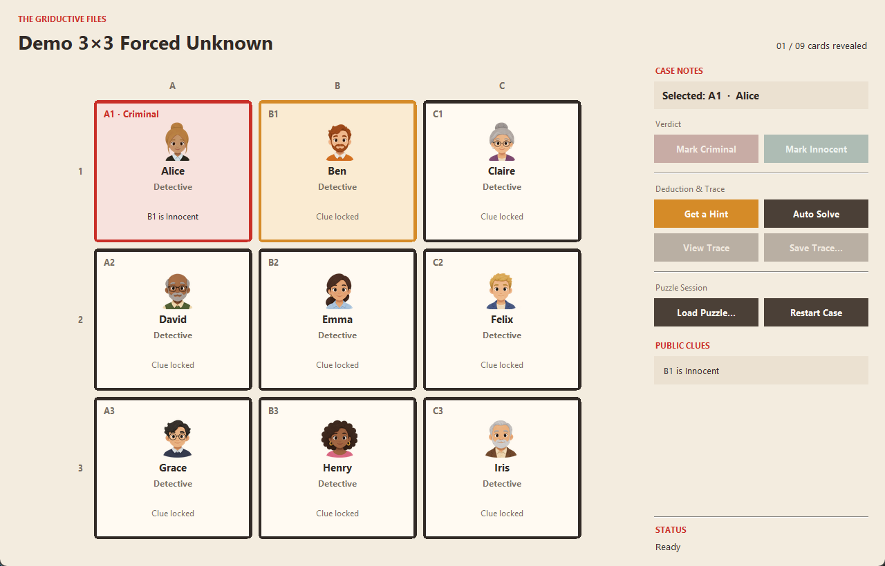
*Hình 1: Board 3×3 (`demo_forced_unknown.json`) lúc khởi tạo — chỉ A1 mở, các ô còn lại hiển thị `Clue locked`; chọn A1 highlight trực tiếp ô B1 bằng khung vàng hổ phách.*

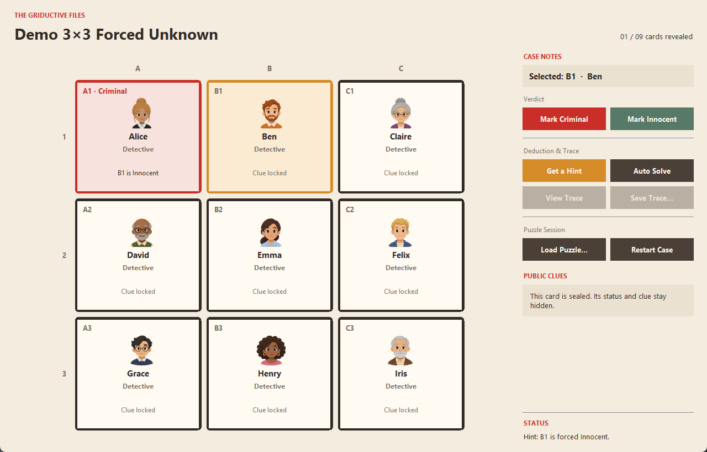
*Hình 2: Sau khi bấm `Get a Hint` — Agent chọn ô forced đầu theo thứ tự row-major (`B1`), bật hai nút Verdict và báo `Hint: B1 is forced Innocent.` trong khi tiến độ vẫn giữ `01 / 09 cards revealed` (Hint không reveal thẻ).*

### 4.2. Manual Verdict: Từ chối (`CONTRADICTED`) và Chấp nhận (`ACCEPTED`)

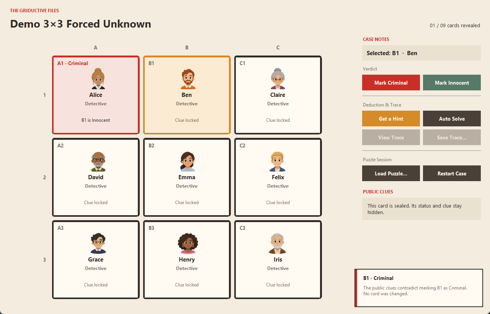
*Hình 3: Người dùng thử gán `B1 = Criminal` — Engine kiểm chứng phát hiện mâu thuẫn với KB công khai (`CONTRADICTED`), thông báo rõ và giữ nguyên trạng thái board (`01 / 09`).*

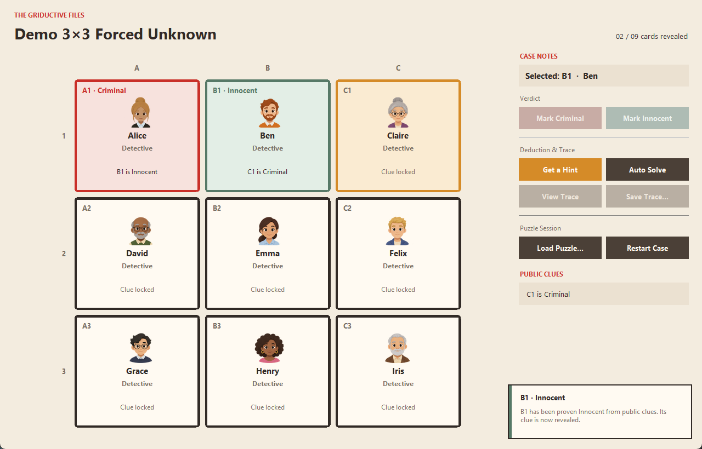
*Hình 4: Gán `B1 = Innocent` được chứng minh hợp lệ (`ACCEPTED`) — chỉ thẻ B1 mở xanh `Innocent`, tiết lộ clue `C1 is Criminal`, tự động highlight `C1` và tăng tiến độ lên `02 / 09`.*

### 4.3. Auto Solve (`SOLVED` & `STUCK`) và Cửa sổ Xem Trace

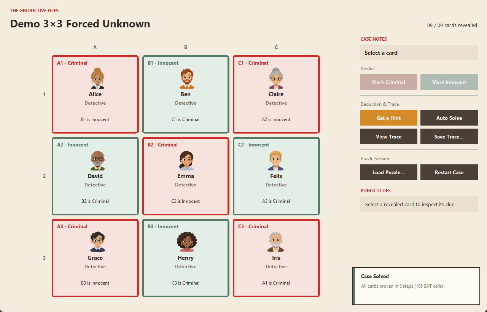
*Hình 5: `Auto Solve` hoàn tất trên `demo_forced_unknown.json` (`SOLVED`, 8 bước, 105 SAT calls), lật đủ 9/9 thẻ và mở khóa hai nút `View Trace` và `Save Trace…`.*

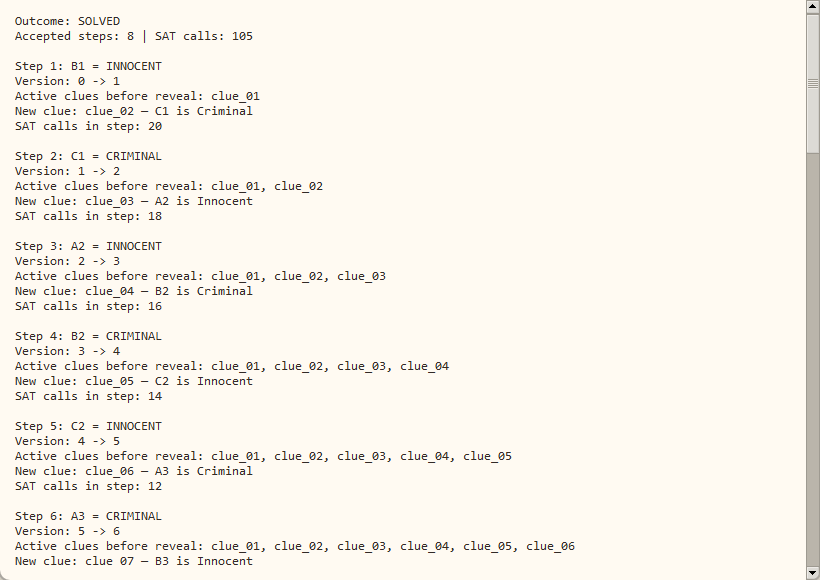
*Hình 6: Cửa sổ `Deduction Trace` từ phiên Auto Solve 3×3 — liệt kê từng bước đã chấp nhận, chuyển đổi version, danh sách `active_clue_ids` trước reveal, clue mới mở và toàn bộ 105 SAT calls hoàn tất (không có hidden assignment).*

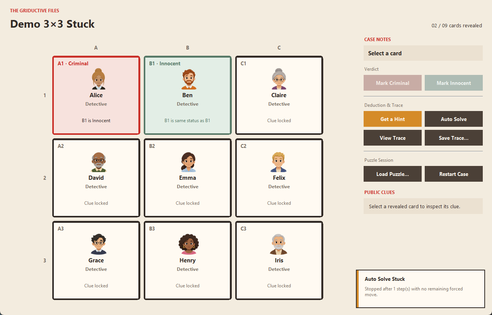
*Hình 7: Chạy `Auto Solve` trên `demo_stuck.json` — sau khi mở 1 thẻ forced (`B1`), không còn suy luận bắt buộc nào khác nên Agent dừng `STUCK`, giữ nguyên 7 thẻ úp và không đoán.*

### 4.4. Board 4×4, Xử lý dữ liệu lỗi và Kiểm chứng kích thước tối thiểu

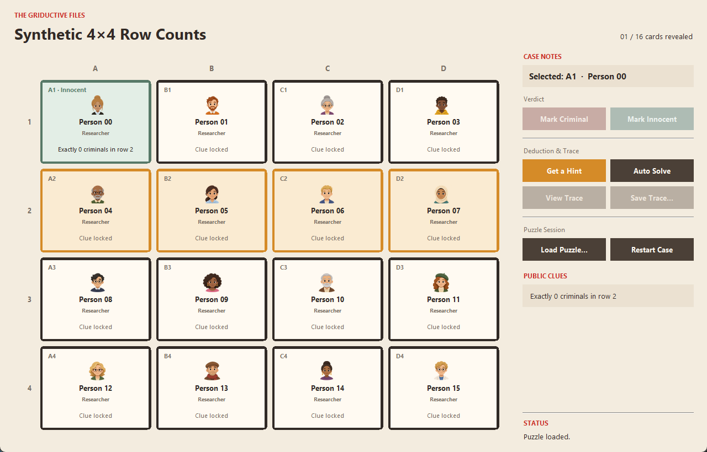
*Hình 8: Board 4×4 (`synthetic_4x4_row_counts.json`) — chọn A1 (`Exactly 0 criminals in row 2`) highlight trọn hàng 2 (`A2, B2, C2, D2`); cả 16 thẻ hiển thị rõ thông tin không bị cắt chữ.*

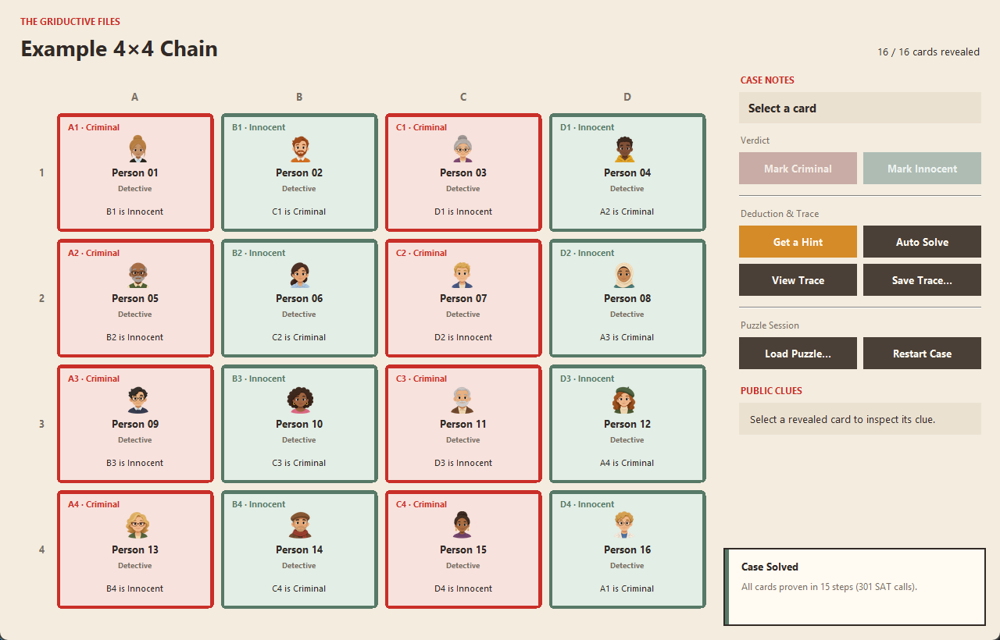
*Hình 9: Chuyển sang `puzzles/4x4/example_01.json` (cùng kích thước 4×4) và chạy `Auto Solve` — tên/nghề được làm mới đúng (`Person 01..16`, `Detective`) và giải đủ `16 / 16` trong 15 bước (301 SAT calls).*

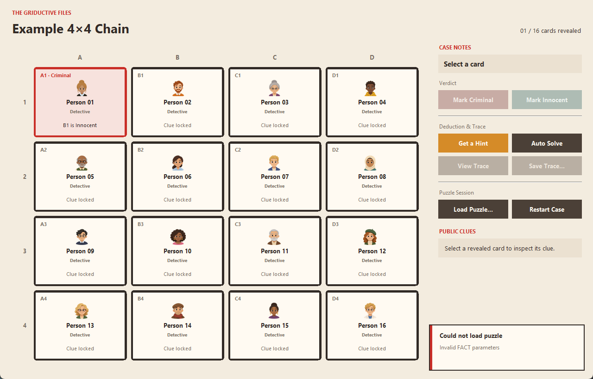
*Hình 10: Thử `Load Puzzle…` với fixture lỗi `invalid_reference.json` — bộ nạp báo `PuzzleValidationError` (`Invalid FACT parameters`) và giữ nguyên hoàn toàn phiên 4×4 hiện tại.*

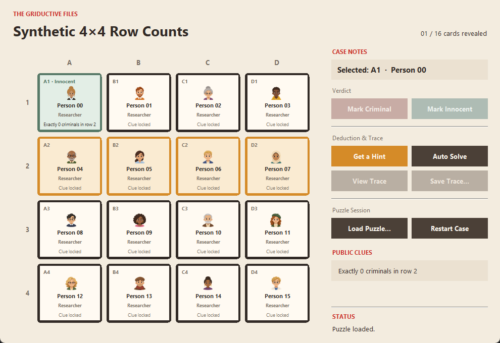
*Hình 11: Kiểm chứng đáp ứng bố cục trên board 4×4 ở kích thước cửa sổ tối thiểu `990×680` — toàn bộ 16 thẻ, thanh điều khiển, `PUBLIC CLUES` và `STATUS` đều nằm gọn trong khung nhìn.*

---

## 5. Hướng dẫn cài đặt, chạy và kiểm thử trên môi trường sạch

### Yêu cầu môi trường

- **Python 3.11** (khuyến nghị cùng minor 3.11.x, có sẵn thư viện chuẩn `tkinter`/`ttk`).
- Không cài gói vào Python toàn cục; sử dụng môi trường ảo `.venv` và bộ phiên bản cố định tại `Source/requirements.txt` (nạp `Source/requirements.lock.txt`, gồm `jsonschema==4.24.0`, `pillow==11.2.1`, `pytest==8.3.5`, `ruff==0.11.13`, `matplotlib==3.10.3` và các gói phụ thuộc).

### Các bước cài đặt và chạy (Windows PowerShell)

Từ thư mục gốc repository:

```powershell
py -3.11 -m venv .venv
.\.venv\Scripts\Activate.ps1
cd Source
python -m pip install -r requirements.txt
python -m pip check
python main.py
```

*(Nếu hệ thống không có launcher `py`, thay dòng đầu bằng đường dẫn trực tiếp tới `python.exe` của Python 3.11, ví dụ `python -m venv .venv`.)*

### Lệnh kiểm thử, lint và thực nghiệm (chạy từ `Source/`)

```powershell
python -m pytest tests -q -p no:cacheprovider
python -m ruff check . --no-cache
python -m ruff format --check . --no-cache
python -m experiments.benchmark --mode all --repeats 3
python -m experiments.phase3 --repeats 3 --timeout 10
```

### Hướng dẫn thao tác nhanh trong GUI

1. **Xem clue & vùng ảnh hưởng**: Nhấp vào một thẻ đã mở để đọc clue ở `PUBLIC CLUES` và xem các ô liên quan được highlight màu vàng hổ phách.
2. **Đánh dấu thủ công**: Nhấp vào một thẻ đang úp rồi bấm `Mark Criminal` hoặc `Mark Innocent`. Chỉ verdict được chứng minh bằng entailment từ KB công khai mới được chấp nhận và mở thẻ.
3. **Gợi ý (`Get a Hint`)**: Hệ thống chọn và nhấp nháy ô suy luận bắt buộc đầu tiên theo thứ tự row-major mà không làm thay đổi trạng thái bàn chơi.
4. **Tự động giải (`Auto Solve`)**: Chạy vòng suy luận tuần tự trên nền, phát hoạt ảnh lật từng thẻ theo thứ tự chứng minh và dừng tại `SOLVED`, `STUCK`, `INCONSISTENT` hoặc `CANCELLED`.
5. **Xem & lưu trace**: Sau khi `Auto Solve` hoàn tất, dùng `View Trace` để đọc từng bước công khai hoặc `Save Trace…` để lưu JSON vào `Source/outputs/traces/`.
6. **Đổi bài / chơi lại**: Dùng `Load Puzzle…` để nạp file JSON từ `Source/puzzles/` hoặc `Restart Case` để đặt lại phiên hiện tại (kể cả khi `Auto Solve` đang chạy).

### Kết quả kiểm chứng môi trường sạch (20/11/2026)

Trên một virtual environment Python **3.11.9** tạo mới hoàn toàn trên Windows 64-bit:

- Cài đặt từ `Source/requirements.txt`: thành công trọn bộ 22 gói đúng lockfile; `pip check` không báo lỗi.
- `Tk/Tcl`: phiên bản 8.6 hoạt động ổn định, `python main.py` khởi tạo và đóng sạch.
- `pytest tests`: **564 / 564 passed** (50.25s), bao gồm **21 test GUI** (controller + race/reset + timeout/error + real Tkinter 3×3/4×4).
- `ruff check` và `ruff format --check`: đạt toàn bộ **41 file Python**.

Chi tiết bảng nghiệm thu từng tiêu chí và danh sách lỗi thực tế đã xử lý xem tại `docs/tv5_stage4_acceptance.md`.

---

## 6. Hạn chế đã biết

- `Save Trace…` xuất mảng các `DeductionStep` theo contract `save_trace(steps, path)` (không chứa các SAT calls của bước kiểm tra cuối không sinh reveal); toàn bộ SAT calls vẫn được hiển thị đầy đủ trong cửa sổ `View Trace`.
- Việc hủy `Auto Solve` khi bấm `Load`/`Restart` có tính chất hợp tác (cooperative cancellation giữa các bước suy luận): nếu một lệnh gọi DPLL đơn lẻ đang chạy rất lâu, kết quả phiên cũ sẽ bị chặn commit bằng `StateToken` và loại bỏ khi trả về, nhưng bản thân luồng DPLL không bị ngắt cưỡng bức giữa chừng.
- Đã nghiệm thu trực quan đầy đủ trên board `3×3` và `4×4` (gồm cả `1280×820` và `990×680`); board `5×5` được hỗ trợ tính toán kích thước thẻ tự động trong `BoardView` nhưng chưa có bộ puzzle 5×5 chính thức để nghiệm thu người dùng cuối.
